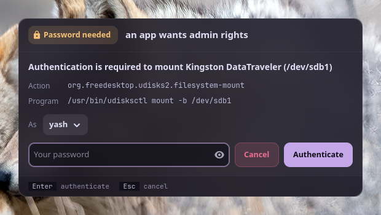

<p align="center">
  <picture>
    <source media="(prefers-color-scheme: dark)" srcset="assets/banner-dark.svg">
    <source media="(prefers-color-scheme: light)" srcset="assets/banner-light.svg">
    
  </picture>
</p>

<p align="center">
  <b>Your system's password prompts, in your desktop's look.</b><br>
  A polkit agent for desktops that don't bring one: when an app needs admin rights, a window asks, and says who's asking and why.
</p>

<p align="center">
  <a href="https://github.com/Theyashsawarkar/pramana/actions/workflows/ci.yml"></a>
  <a href="https://github.com/Theyashsawarkar/pramana/releases"></a>
  <a href="LICENSE"></a>
  
</p>

<p align="center">
  
</p>

> *Pramāṇa* (प्रमाण) is Sanskrit for "proof, means of knowing": the window
> where you prove it's you.

Apps on Linux ask for admin rights through polkit: mounting a USB drive,
changing the time zone, installing an update from a software centre,
`pkexec`. polkit then asks the session's *authentication agent* to get your
password. GNOME and KDE bring one; sway, Hyprland, river and other
compositors don't, and without it those requests just fail, often with no
message at all. pramana is that agent: a small GTK 4 window that shows
polkit's message, what's asking, and takes your password.

## Contents

- [Features](#features)
- [Install](#install)
- [What you see](#what-you-see)
- [Security](#security)
- [How it works](#how-it-works)
- [Troubleshooting](#troubleshooting)
- [Contributing](#contributing)
- [License](#license)

## Features

- **Says who's asking**: polkit's message, the action id
  (`org.freedesktop.udisks2.filesystem-mount`) and the program or command
  line, as polkit reports them.
- **Your password goes to polkit only**: to its setuid helper, which checks
  it with PAM. pramana never stores, logs or passes it on.
- **Pick who to authenticate as** when polkit accepts several admins (you
  first, when you're one).
- **Try again** after a wrong password; Esc cancels and the app is told no.
- **Looks like your desktop**: [Vyom](https://github.com/Theyashsawarkar/vyom)'s
  panels, in your [varna](https://github.com/Theyashsawarkar/varna) theme,
  the same window style as [anumati](https://github.com/Theyashsawarkar/anumati).
- **Always there**: a systemd user service in the graphical session that
  restarts on failure and steps aside if another agent already runs.
- **Root-owned install**: no program running as you can edit the window
  that takes your password.
- **Answer from your phone**: with [ekatva](https://github.com/Theyashsawarkar/ekatva)
  running, the request also shows on your paired phone; your password typed
  there goes into this window and on to polkit, exactly as if typed here
  ([ADR 4](docs/adr/0004-answer-from-the-phone.md)).

## Install

Requirements: Linux with a Wayland or X11 desktop, systemd's user manager,
polkit, Python 3.11+, PyGObject, GTK 4 and libadwaita.

```sh
git clone https://github.com/Theyashsawarkar/pramana ~/.local/share/pramana
~/.local/share/pramana/install.sh          # asks for sudo once
pkexec true                                # the window opens; authenticate
```

`install.sh` installs `/usr/local/lib/pramana/` and
`/usr/local/lib/systemd/user/pramana.service` **root-owned**, links
`/usr/local/bin/pramana`, and enables the service, which starts with your
graphical session (`graphical-session.target`). On Arch it installs the
dependencies too; elsewhere install them first (Debian/Ubuntu: `python3-gi
gir1.2-gtk-4.0 gir1.2-adw-1 gir1.2-polkit-1.0`; Fedora: `python3-gobject
gtk4 libadwaita polkit-libs`).

```sh
~/.local/share/pramana/install.sh --check       # what differs from this clone
git -C ~/.local/share/pramana pull && ~/.local/share/pramana/install.sh   # update
~/.local/share/pramana/install.sh --uninstall
```

If your desktop doesn't start `graphical-session.target`, start it from
your compositor's config instead: sway `exec systemctl --user start pramana`.
Remove any other agent you run (`polkit-gnome`, `lxpolkit`,
`hyprpolkitagent`): one session has one agent.

## What you see

When an app asks, a window opens with polkit's message ("Authentication
is required to mount Kingston DataTraveler"), the action and the program,
and a password field. Type your password and press Enter. A wrong password
says so and lets you try again.

| Key | Action |
|---|---|
| `Enter` | Authenticate with the typed password |
| `Esc` | Cancel the request (the app is told no) |

`pramana --preview` shows the window with a sample request, without
polkit, to check how it looks in your theme.

## Security

| Guarantee | How |
|---|---|
| The password goes to polkit only | It's handed to `PolkitAgent.Session`, which writes it to polkit's setuid helper (`polkit-agent-helper-1`), which checks it with PAM. The field is cleared as soon as it's sent; nothing is logged but the action id and the outcome. |
| What the window says is what polkit said | The message, action and program come straight from polkit. The window's code is root-owned in `/usr/local`, Python runs isolated (`-I`), and the theme's colours are read as plain `#rrggbb` only and used only while every text stays readable ([ADR 2](docs/adr/0002-themed-but-never-hidden.md)). |
| Only your session | It registers for your graphical session only; polkit itself decides which requests need a password and whose. |
| Answering from the phone changes none of this | The phone's answer, over ekatva's end-to-end encrypted link, fills this window's password field and goes the same way. The window sends nothing secret out and finds ekatva by your uid, not the environment ([ADR 4](docs/adr/0004-answer-from-the-phone.md)). |

What it **can't** do: protect you from a program that is actively malicious
and already running as your user. Such a program could draw a lookalike
window, or stop the service and register its own agent. That's true of
every polkit agent on a Linux desktop. Report security problems privately:
[SECURITY.md](SECURITY.md).

## How it works

1. The `pramana` user service runs `/usr/local/lib/pramana/agent.py` in
   your graphical session. It registers with polkit as the authentication
   agent for your session (`XDG_SESSION_ID`, else logind's display session).
2. An app asks polkit for an action that needs a password. polkit calls
   pramana with the message, the action, details about the caller, and the
   identities it accepts.
3. pramana opens the window. You type your password; it starts a
   `PolkitAgent.Session` for the chosen identity, which runs polkit's
   helper and answers its prompt with the password.
4. The helper tells polkit whether it worked; polkit grants or refuses the
   app. Esc, or closing the window, cancels the request.

Logs: `journalctl --user -u pramana`.

## Troubleshooting

- **No window appears; the app says "not authorized".** Check the service:
  `systemctl --user status pramana`. "can't register as the session's
  polkit agent" means another agent already runs: remove it, then
  `systemctl --user restart pramana`.
- **The window says the password didn't work, though it's right.** polkit
  asks for an admin's password: your user must be one (the `wheel` group on
  Arch, `sudo` on Debian), or pick the admin under *As*.
- **The window looks unstyled or tiny.** Install libadwaita; on a tiling
  compositor, float it: sway `for_window [app_id="^io\.github\.theyashsawarkar\.Pramana$"] floating enable`.

## Contributing

Bug reports, ideas and pull requests are welcome: see
[CONTRIBUTING.md](CONTRIBUTING.md), and [CHANGELOG.md](CHANGELOG.md) for
what changed in each release. Security reports go privately
([SECURITY.md](SECURITY.md)).

pramana comes from [Vayu](https://github.com/Theyashsawarkar/vayu), a
keyboard-driven Wayland desktop, and works on any Linux desktop without its
own polkit agent.

## License

[MIT](LICENSE)
